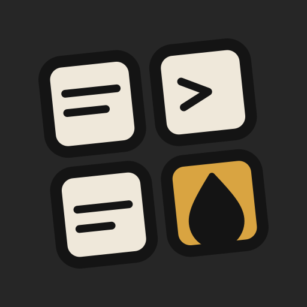
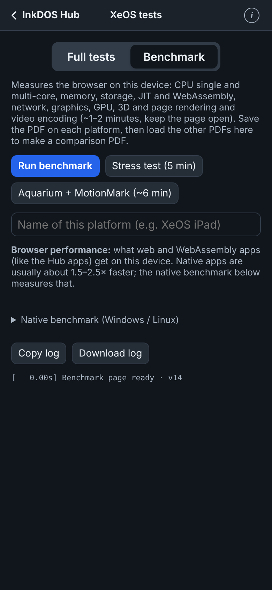
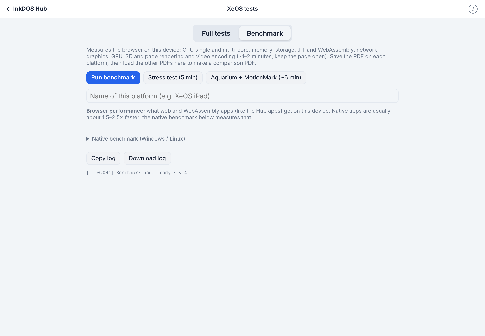

<h1 align="center">InkBench</h1>

Benchmark for the browser: CPU, memory, storage, graphics and video scores you can compare across iPad, iPhone and PC.

<b><a href="https://hub.inkdos.workers.dev/InkBench/">Open InkBench</a></b> · part of <a href="https://github.com/InkDOSHub/inkdoshub.github.io">InkDOS Hub</a> · MIT license

 

## What it does

- **Benchmark** (`?bench`): Geekbench-style scores (1000 = reference) for CPU single and multi-core (JavaScript and WebAssembly), memory, OPFS/IndexedDB storage, JIT, network, canvas/WebGL2/WebGPU, WebCodecs 1080p video, a tile renderer and a GPU stress donut.
- **Stress test (5 min)**: CPU and GPU over time, to see thermal throttling.
- **Aquarium + MotionMark** (~6 min): local copies of WebGL Aquarium and WebKit's MotionMark.
- **Results as PDF**: the data travels inside the PDF, so "Load PDF to compare" puts up to 4 platforms side by side.
- **Native benchmark**: `native/inkbench.ps1` (Windows) and `native/inkbench.sh` (Linux) run 7-Zip, smallpt, STREAM and disk tests and save a file in the same format, to compare web apps with native ones.
- **Full tests**: ~90 checks of what the browser allows (storage, camera, files, pop-ups, workers…), first made to map XeOS on iPad.

## Files

| Path | What |
|---|---|
| `index.html`, `abas.js` | Page and tabs |
| `bench.js` | Benchmark (current version); `v9.html` + `bench-v9.js` keep version 9 |
| `app.js` | Full browser tests |
| `aquarium/`, `motionmark/` | Local copies of the graphics benchmarks |
| `native/` | Native benchmark scripts |

## Part of InkDOS Hub

InkBench is one of the apps of [InkDOS Hub](https://hub.inkdos.workers.dev/), a free, open-source home screen of tools for iPad, iPhone and PC. It is published by GitHub Pages at `inkdoshub.github.io/InkBench/`, on the same site as the Hub, so it shares the Hub's top bar, theme and language files (`/assets/`). The public address `hub.inkdos.workers.dev/InkBench/` is the Hub's Cloudflare Worker, which serves these files with cross-origin isolation (multithreaded WebAssembly).

Other InkDOS Hub repositories: [Hub](https://github.com/InkDOSHub/inkdoshub.github.io) · [InkSoC](https://github.com/InkDOSHub/InkSoC) · [InkShell](https://github.com/InkDOSHub/InkShell) · [InkCam](https://github.com/InkDOSHub/InkCam) · [InkMind](https://github.com/InkDOSHub/InkMind) · [InkArcade](https://github.com/InkDOSHub/InkArcade) · [InkBench](https://github.com/InkDOSHub/InkBench)

## License

Code made here: [MIT](LICENSE). Third party: WebGL Aquarium (BSD-3-Clause, Google, `aquarium/LICENSE.md`) and MotionMark (BSD-2-Clause, Apple/WebKit, license in each file).
